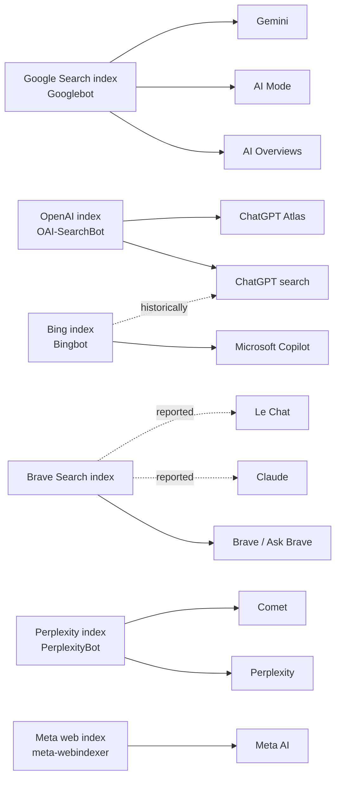

Every conversation about "blocking AI" assumes that if you don't want AI using your content, you can say no. My data suggests that's only true for the AI engines that matter least.

I've spent the last few weeks building two datasets: a [reference of 18 AI search engines](/data/ai-search) (where each one gets its answers, which crawlers feed it, and how its traffic shows up in analytics) and a [study of the robots.txt files of the top 10,000 websites](/data/ai-search/robots-txt-study). On their own, each is a lookup table. Put together, they reveal an asymmetry that changes how you should think about AI visibility, AI opt-outs and AI analytics.

> **The AI surfaces with the most users are the ones you can't opt out of without leaving Google, and the ones whose traffic you can't see. The ones you can block and measure are the smaller engines.**

***

## **1. Who actually reaches people**

Start with reach, using only figures the companies have stated themselves (all sourced in the [user numbers dataset](/data/ai-search/user-numbers)).

Google says AI Overviews reach more than **2.5 billion people a month** and AI Mode passed **1 billion monthly users** by May 2026. The Gemini app has **950 million monthly users**. OpenAI says **1.2 billion people use ChatGPT each week**.

Weekly and monthly numbers aren't directly comparable, and ChatGPT's weekly count means its monthly audience is larger. But the order of magnitude is clear: three Google surfaces together put AI-generated answers in front of billions of people every month, and ChatGPT is the only non-Google product in the same league. Perplexity, Claude, Copilot, Meta AI, Grok and the rest each operate at a fraction of that scale.

Growth is converging too. ChatGPT tripled its weekly users in 20 months, from 400 million in February 2025 to 1.2 billion in October 2026.

Over the most comparable recent window, though, Gemini grew faster: from 450 million to 950 million monthly users between July 2025 and July 2026, a 2.1x increase in 12 months. ChatGPT went from 700 million to 1.2 billion weekly users between July 2025 and October 2026, 1.7x in 15 months. Gemini's growth comes with Android, Chrome and Workspace distribution attached, which is not something a standalone app can buy.

## **2. There are only a few indexes underneath**

Eighteen AI engines sounds like a crowded market. Underneath, there are far fewer independent sources of web data. Here's who each engine relies on, based on official documentation and reporting compiled in the [engine reference](/data/ai-search):

Three things stand out.

- **Google's index feeds three of the four largest AI surfaces.** AI Overviews, AI Mode and Gemini all ground their answers in Google Search.
- **Brave is the quiet kingmaker.** Its independent index (35+ billion pages) powers Brave's own AI answers and has been reported as the search backend for Claude and Le Chat. A page that ranks well in Brave can surface in assistants that never crawled it themselves.
- **OpenAI is building its way out of dependence.** ChatGPT search started on Bing, and 2025 reporting showed Google results reaching it through a scraping API. Its own crawler, OAI-SearchBot, now builds an index OpenAI controls. That index is the one you opt into or out of with robots.txt.

## **3. The opt-out asymmetry**

Now overlay the robots.txt data. For each engine, I took the crawler that actually controls whether your content appears in its answers, and measured how many of the top 10,000 sites block it.

- To leave **ChatGPT** answers, block OAI-SearchBot: 7.6% of sites do.
- To leave **Claude**, block Claude-SearchBot: 7.4% do (and it may not be enough if Claude is citing you through Brave's results).
- To leave **Perplexity**, block PerplexityBot: 11.1% do.
- To keep your content out of **Gemini's** training and grounding, block Google-Extended: 15.5% do.
- To leave **AI Overviews and AI Mode**, you have to block Googlebot, which removes you from Google Search entirely. Only 2.4% of sites do, and 131 of those 137 are sites that block every crawler with a blanket rule.

Here's the striking part. **667 sites explicitly block Google-Extended. Exactly one of them also blocks Googlebot.** The other 666 have presumably decided they don't want their content used by Google's AI. Their content still appears in AI Overviews and AI Mode, the two Google AI surfaces with the most users, because Google-Extended doesn't govern them.

So the opt-outs publishers actually use apply to ChatGPT, Claude, Perplexity and the long tail. The largest AI surface on the internet, built on Google's index and shown to more than 2.5 billion people a month, can't be refused without disappearing from search. **The leverage publishers have over AI is inversely proportional to the reach of the AI.**

That isn't a conspiracy; it's a consequence of AI Overviews being a search feature rather than a separate product. But it means the robots.txt debate is mostly a debate about the challengers. Whatever the incumbent does with your content, your only lever is whether you want to be in Google at all.

## **4. The visibility asymmetry: the biggest AI surface is invisible in your analytics**

The same split shows up in measurement. From the [referrer dataset](/data/ai-search/referrers):

- **ChatGPT** sends `chatgpt.com` as a referrer and appends `utm_source=chatgpt.com` to cited links, making it the easiest AI source to track.
- **Perplexity, Claude, Copilot, Gemini, DeepSeek, Le Chat** each send their own referrer hostname. One regex in GA4 catches all of them.
- **AI Overviews and AI Mode** send `google.com`. Their clicks land in Organic Search alongside everything else, and Search Console doesn't separate them out.

So the AI engines you can block are also the ones you can measure, and the ones you can't block are the ones you can't see. When a marketing team reports "AI referral traffic is 1% of sessions", it is almost always describing ChatGPT, Perplexity and friends, and silently excluding the AI surface with the largest audience, which is counted as "organic".

> **"AI traffic" in most dashboards is really "non-Google AI traffic". The biggest AI channel is hiding inside your SEO numbers.**

## **5. What publishers are actually doing**

Given this, publishers' behaviour makes more sense than it first appears. Across the top 10,000 sites, training crawlers are blocked about twice as often as answer crawlers. GPTBot is blocked by 17.9% of sites and OAI-SearchBot by 7.6%; ClaudeBot by 16.9% and Claude-SearchBot by 7.4%. Most publishers are making a narrow, rational bet: refuse to be a free dataset, keep being a source.

What the data shows they haven't fully absorbed is the Google exception. Google-Extended is the fifth most-blocked AI crawler token on the web. For most of the sites that use it, it does not do what its name suggests.

## **What to do about it**

1. **Separate training from answers in your robots.txt.** Block training crawlers if you want to; think hard before blocking OAI-SearchBot, Claude-SearchBot or PerplexityBot. The [crawler directory](/data/ai-search/crawlers) has every token and what it controls.
2. **Don't rely on Google-Extended for AI Overviews.** If you need to limit what Google's AI quotes, page-level `nosnippet` and `max-snippet` are the tools that exist. They also affect regular snippets.
3. **Rank in Brave, not just Google.** If your audience uses Claude or Le Chat, Brave Search visibility is part of your AI visibility.
4. **Fix your attribution.** Add an AI channel in GA4 using the [referrer regex](/data/ai-search/referrers), and treat the gap between Google impressions and clicks as your AI Overviews exposure, because no tool will report it to you directly.
5. **Watch the indexes, not the apps.** New AI products launch every month; new indexes don't. Your visibility depends on a handful of crawlers: Googlebot, OAI-SearchBot, Bingbot, Brave's crawler and PerplexityBot. Make sure they can read you.

## **Data and method**

This piece combines four datasets, all free to download: the [AI search engine reference](/data/ai-search), [AI user numbers](/data/ai-search/user-numbers), the [robots.txt study](/data/ai-search/robots-txt-study) and [AI referrer domains](/data/ai-search/referrers). User figures are as stated by the companies themselves. Block rates are shares of the 5,701 top-10k domains that serve a valid robots.txt, parsed per RFC 9309. Index relationships marked "reported" come from third-party reporting, not official confirmation. See the [methodology](/data/methodology).

Free to reuse under CC BY 4.0, with a link back to the dataset you used.
